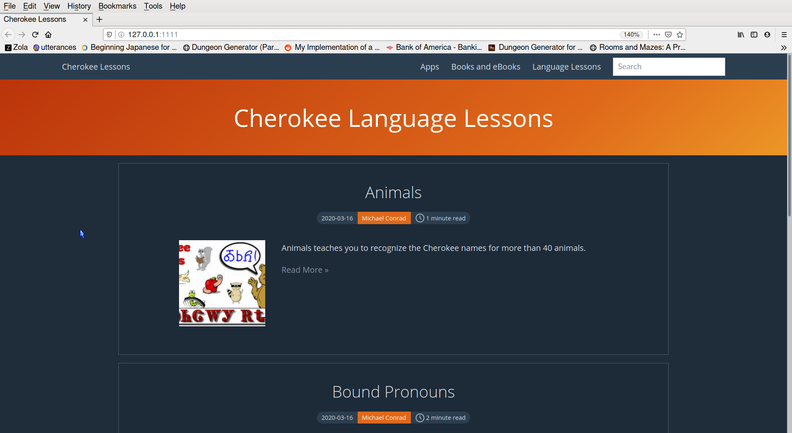

# CherokeeLessons.com

The new and improved CherokeeLessons.com using the Zola static site generator.

## Building and publishing

The zola version is pinned in `ZOLA_VERSION` (currently 0.22.1 — the latest
release compatible with the vendored Zulma theme).

- `./build.sh` downloads the pinned zola release binary on first use (cached
  as `./zola`, gitignored), reports its version, and builds the site into
  `public/`.
- `./publish.sh` builds via `./build.sh` and rsyncs `public/` to the publish
  host (gated to `omen-desktop`).

## Notes

postWeight=$(("$(date +%s)" / 10 * 10))
postDate="$(TZ=UTC date -u --iso-8601=seconds|cut -f 1 -d '+')Z"
echo "post weight: $postWeight"
echo "post date: $postDate"
